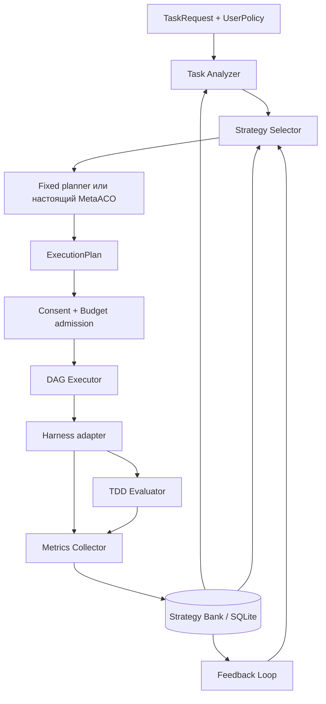

# Архитектурный аудит и план развития

Статус: архитектура и начало первого этапа согласованы пользователем 25 октября 2026. Аудит ниже фиксирует состояние до реализации; Strategy Bank описан отдельно в [ADR 0001](adr/0001-strategy-bank.md).

## 1. Основание и границы проверки

Проверены все исходники и тесты текущего checkout `e6e28d7`, README и обе архитектурные заметки, package.json и опубликованные зависимости, уже установленные локально. GitHub подтверждает эту ревизию ветки `codex/metaaco-agent-resources`. На момент аудита `main` находится на `08e0a1e`; PR #2 и #3 ещё открыты. Поэтому ниже отдельно учитывается функциональность текущей ветки, которая не вся вошла в main. Этот документ предлагается отдельным PR поверх ветки PR #3; перед переносом на main требуется завершить цепочку предыдущих PR или перебазировать документацию.

Проверка без API: 11 JS unit/contract и 3 Harness integration теста прошли; один integration и все 10 Python-тестов пропущены из-за отсутствия METAACO_SOURCE. Это не подтверждение работы внешнего решателя в текущем окружении. Node запущен из установленного runtime, поскольку в PATH его нет. Новые зависимости не устанавливались. Внешний Python MetaACO не входит в репозиторий, его исходники и свойства элитного банка в этом аудите не проверены.

## 2. Что уже реализовано

| Компонент | Фактическое состояние | Основание |
|---|---|---|
| DeepSeek Harness | Рабочий адаптер фиксированного workflow, preview, явный запуск slash-команды, отмена и dispose | index.js, test/unit.test.js, test/integration.test.js |
| Контракт планирования | Строгие планы v1/v2, снимок проверенного плана, запрет неизвестных полей | planner.js, test/planner.test.js |
| Настоящий MetaACO | Мост к внешнему solve_rcpsp_psplib / ColonyManager; без фиктивного fallback | python/metaaco_plan.py, python/agent_problem.py |
| Ресурсная модель | DAG на входе Python, один слот на задачу, оценки длительности, 3 колонии при агентном входе | python/agent_problem.py |
| Исполнитель | Последовательные стадии, параллельные дети внутри стадии; остановка зависимых стадий при null | SCRIPT в index.js |
| Strategy Bank | Отсутствует: нет хранения стратегий, запусков или ошибок | Исходники проекта |
| TDD Evaluator | Отсутствует. Тесты самого плагина не оценивают решения задач | test/, python/test_* |
| Metrics Collector | Только runId, agentsStarted, итоговый ответ; оценки makespan отдельно в плане | index.js, planner.js |
| Task Analyzer / Selector | Отсутствуют | Исходники проекта |
| Feedback / экспериментальный стенд | Отсутствуют | Исходники проекта |

Главный вывод: есть интеграционный каркас планировщика и исполнителя, но ещё нет адаптивной системы выбора стратегий.

## 3. Ограничения и необходимые изменения

1. `completed` сейчас означает завершение workflow, а не корректность кода. Новый прикладной итог должен определяться только независимым evaluator после обязательных тестов.
2. `start-groups` теряет перекрытие работ разных стартовых времён. Для A=30, B=20, C=10 после B расписание может дать 30 секунд, а группы — 40. Нельзя выдавать улучшение scheduleMakespan за ускорение реального запуска.
3. JS-план не содержит исходного DAG, назначения моделей и связей артефактов. Добавлять их следует новым контрактом v3, сохраняя v1/v2 без изменения смысла.
4. Ответы сохраняются в локальном results, но не передаются следующим задачам. Требуются явные входы/выходы, provenance и передача только результатов успешных предшественников.
5. Сейчас модель наследуется от parent. Harness поддерживает agentOptions у subagent, однако публичный путь назначения модели и получения usage нужно подтвердить отдельными contract-тестами на закреплённой версии. До подтверждения неподдерживаемые назначения отклоняются.
6. Нет общей квоты между запусками и контроля вложенных агентов. Потребуются общий admission controller и профиль с ограничением вложенной делегации, иначе полный учёт ресурсов невозможен.
7. `runWorkflow()` сам не требует allowLlm; право проверяет вызывающий код. Для нового orchestration API вводится единый gate до любых provider-запусков; старый API сохраняется и явно документируется как низкоуровневый.
8. Ревизия внешнего MetaACO не закреплена; Python-проверки полностью зависят от необязательной переменной окружения. Нужны manifest ревизии и отдельная обязательная CI-проверка реального решателя перед заявлениями о MetaACO.
9. Для прямого runWorkflow в отличие от validatePlan отсутствует отдельный снимок входа. Унифицировать immutable validation при последующем изменении runtime.
10. Нет CI, миграций хранилища, воспроизводимого набора задач и сохранения промежуточного состояния. Это часть инфраструктуры, а не усовершенствование алгоритма.

## 4. Предлагаемая архитектура

Оставить Node.js ESM основным orchestration слоем, Python — адаптером настоящего MetaACO. Не вводить сервисную сеть и переписывание на TypeScript на первом этапе. Контракты описать JSON Schema и JSDoc; Python/JS проверять общими JSON fixtures.



Evaluator вызывается также между фазами RED/GREEN/REFACTOR; схема показывает итоговый поток. Collector получает события всего жизненного цикла, включая планирование, тесты, ошибки и отмену. Сырые попытки хранятся сразу; агрегаты selector обновляются только после завершения оценки.

SQLite — первоначальное локальное хранилище с транзакциями, миграциями и экспортом JSONL. Файлы патчей, логи и отчёты — content-addressed артефакты вне БД. Python не пишет в БД: единственный владелец записи — Node orchestration. База хранит стратегии неизменяемых версий, задачи, попытки, события, вызовы моделей, тестовые прогоны, решения selector и версии агрегатов. Одна задача может иметь много попыток, каждая — много model calls и test runs. Прерывание процесса оставляет running, которое при восстановлении помечается interrupted; автоматический повтор платного вызова запрещён без действующей квоты и разрешения.

## 5. Контракты данных и интерфейсы

Все сериализованные сущности имеют schemaVersion, устойчивый id, UTC timestamps и provenance; execution/strategy/model revisions фиксируются. Денежные значения — целые microunits с currency, время измерений — миллисекунды. Неполные данные обозначаются null и причиной, никогда фиктивным нулём.

| Контракт | Обязательное содержание |
|---|---|
| TaskRequest | taskId, описание, repo/baseCommit, acceptance criteria, immutable TestSpec, разрешённые инструменты |
| UserPolicy | веса time/cost/quality, deadlineMs, maxCost, maxConcurrentAgents, разрешённые модели, consent scope; веса неотрицательны и нормированы |
| TaskContext | version признаков, тип задачи, стек, сложность, confidence, источники; признаки вычислены до запуска |
| StrategyDefinition | strategyId/version, workflow DAG, роли и разрешённые model routes, TDD policy, compatibility requirements |
| SelectionDecision | кандидаты, исключения и причины, выбранная версия, score, propensity когда известна, seed, версия policy и snapshot истории |
| ExecutionPlan v3 | DAG nodes/edges, resource demands, model assignment, artifact bindings, estimates с источником и неопределённостью, solver provenance |
| AttemptRecord | attemptId, taskId, strategy version, base/final commit, state, timestamps, selection, references на события/артефакты/оценку |
| ModelCallRecord | provider/model revision, requestId, input/output/cached/reasoning tokens по схеме провайдера, source, pricingSnapshot, calculatedCost; неизвестное отдельно |
| TestReport | phase, command, runner/environment revision, exitCode, passed/failed/skipped counts, duration, logs, test-suite hash, timeout/error |
| EvaluationResult | success/failed/inconclusive, обязательные gates, RED evidence, GREEN и regression reports, независимая оценка, причины |
| Outcome | measured durations/usage, рассчитанная из usage стоимость, provider-reported billing если есть; estimates отдельно; constraint violations |

Предлагаемые интерфейсы (псевдосигнатуры; это не уже реализованные API):

```text
StrategyBank.register(strategy) -> StrategyRef
StrategyBank.findSimilar(context, filters, snapshot) -> HistoricalEvidence[]
StrategyBank.beginAttempt(request, decision) -> AttemptId
StrategyBank.appendEvent(attemptId, eventId, event) -> void
StrategyBank.finalizeAttempt(attemptId, evaluation, outcome) -> void
TaskAnalyzer.analyze(request, repoSnapshot) -> TaskContext
StrategySelector.select(context, candidates, policy, historySnapshot, seed) -> SelectionDecision
Planner.plan(strategy, context, policy, estimates, seed) -> ExecutionPlan
HarnessAdapter.capabilities() -> SupportedCapabilities
HarnessAdapter.execute(node, inputs, modelRoute, executionPermit, signal) -> NodeRun
DAGExecutor.execute(plan, dependencies, executionPermit, signal) -> ExecutionResult
TestRunner.run(testSpec, workspaceSnapshot, phase, signal) -> TestReport
TDDEvaluator.evaluate(attempt, immutableTestSpec, reports) -> EvaluationResult
MetricsCollector.consume(event) -> void
BudgetController.reserve(requestUpperBound) -> Reservation | Rejection
FeedbackLoop.apply(finalizedAttemptId) -> PolicyStateVersion
```

Событие: eventId, attemptId, nodeId/callId когда применимо, sequence, kind, recordedAt, payload. Доставка может повторяться: уникальность eventId и транзакционность защищают usage и feedback от двойного учёта. Terminal status присваивается один раз; поздний billing записывается корректирующим событием с новой версией outcome.

## 6. Правила объективной оценки

TDD: baseline до правок → добавленный целевой тест падает по ожидаемой причине (RED) → реализация проходит этот тест и обязательные проверки (GREEN) → рефакторинг сохраняет прохождение. Ошибка загрузки, отсутствующий runner и timeout не считаются RED. Исходные сломанные тесты сохраняются в baseline и не исключаются молча. Политика задачи явно задаёт допустимость baseline defects; обязательный тест, остающийся красным, всегда запрещает success.

TestSpec фиксируется до решения. Агент не может удалить обязательные тесты или заменить команду проверки. Изолированный evaluator запускает acceptance/regression набор на точном финальном снимке кода; независимые скрытые тесты недоступны агентам и analyzer. LLM-review можно добавить позже как дополнительный сигнал с отдельной стоимостью, но он не отменяет провал тестов. Отсутствие доказательства обязательного TDD даёт inconclusive/failed согласно политике, а не подтверждённый успех.

Измерять отдельно wall time задачи, планирование, очередь, agent active time и test time; суммы параллельных agent durations не равны wall time. Монотонные часы нужны для длительности, UTC — для событий. Собирать usage всех реально наблюдаемых вызовов, в том числе неудачных, retry, evaluator и compaction; недоступные данные отмечать incomplete. Не суммировать overlapping token categories дважды. Cost из токенов и закреплённого тарифа — рассчитанная стоимость, не измеренный счёт провайдера.

Условие success — прохождение всех обязательных gates. Оптимизацию вести только среди допустимых кандидатов. Невыполнимые ограничения возвращают no-feasible-strategy. Для обучения фиксировать reward version: например bounded quality minus нормированные time/cost penalties; неуспех получает отдельный отрицательный reward. Quality gate не заменяется большим весом качества. Лимиты расходов требуют резервирования верхней границы каждого конкурентного вызова и сверки usage; если провайдер не позволяет ограничить/оценить верхнюю стоимость, строгую гарантию не заявлять и такой маршрут для hard budget отклонять. Отмена не отменяет уже начисленные расходы.

## 7. Selector, DAG и MetaACO

Analyzer сначала детерминированный: язык/манифесты/тип изменений/объём/тестовая среда и ручные метки. Similarity — версионированные признаки и explainable distance с фильтром совместимости, без обязательного embedding API. Сложность — прогноз с confidence. Холодный старт допускает явные пользовательские duration estimates.

Selector: сначала воспроизводимые random/fixed/cheapest/historical baselines; затем LinUCB с отдельной статистикой для strategy version и версионированными context features. Логировать exploration, cold-start и tie-breaking. Фильтр hard constraints применяется до exploration; прогноз допустимости не является гарантией. Historical Best использует только сравнимые завершённые прошлые попытки и минимальный объём evidence. Не выбирать только по успешным попыткам: ошибки и стоимость неудач входят в ожидаемый outcome. Online feedback включает историю в следующую версию policy, без её изменения посреди текущего решения.

DAG Executor запускает ready nodes после реального завершения зависимостей, без общего барьера. Проверяет циклы, отсутствующие ссылки, model capabilities и ресурсы до старта. На ошибке блокирует потомков, независимые ветви продолжает или отменяет по явной policy. Обеспечивает cancellation и dispose для каждого NodeRun. Передача результатов — immutable artifact refs с ограничением контекста. Параллельные агенты редактируют отдельные workspace snapshots; integration node применяет патчи и разрешает конфликты, после чего evaluator проверяет объединённый результат. Resume разрешён только при совпадении входных hashes; TDD-фазы одного изменения последовательны.

MetaACO пока сохранить как планировщик makespan. До расширения исследовать и закрепить реальный исходный проект, его многоколониальную реализацию и elite mechanism. Затем определить encoding решений: порядок задач, agent/model assignment, resource constraints и objective evaluator. Нужна настоящая доработка решателя, если его текущий API не поддерживает эти переменные; простой ранжирующий JS wrapper не называть многокритериальным MetaACO. Объективная функция использует прогнозы, обученные на измеренных результатах; качество всё равно подтверждает evaluator после исполнения. Отдельно учитывать время поиска решателя. Внешний elite bank оптимизатора и исторический Strategy Bank имеют разные роли: первый хранит кандидаты расписаний, второй — фактические исполнения и стратегии. Сохранять Pareto frontier допустимых решений; выбор по UserPolicy фиксировать в provenance. Для планирования обязательны offline-тесты реального алгоритма, без fallback при его отсутствии.

## 8. Структура каталогов

```text
index.js                     # стабильный Harness plugin entrypoint
planner.js                   # совместимые exports validate/run v1/v2
src/
  contracts/                 # JSON Schema, JSDoc types, validators
  bank/                      # SQLite repositories, migrations, artifact store
  evaluation/                # test runners, TDD state machine, gates
  metrics/                   # clocks, usage adapters, pricing, budget reservations
  analysis/                  # task features, similarity
  selection/                 # baselines, LinUCB, reward definitions
  execution/                 # DAG scheduler, workspace/artifact management
  adapters/harness/          # model routes, lifecycle, event mapping
  orchestration/             # attempt lifecycle, consent, feedback
python/                      # существующий настоящий MetaACO bridge
test/{contracts,bank,evaluation,metrics,analysis,selection,execution}/
test/integration.test.js     # сохранить существующие regression tests
experiments/                 # manifests, tasks, splits, seeds, reports
docs/adr/                    # принятые решения и границы гарантий
```

Данные запусков размещать в настраиваемом dataDir вне исходников; ключи API, рабочие копии, исходники пользовательских задач и полные логи не включать в npm-пакет. При добавлении src обновить package.json files/exports. Не переносить все файлы заранее: каждая директория появляется вместе с реализацией соответствующего этапа.

## 9. Этапы реализации и готовность

Каждый этап — отдельный PR после согласования; новые компоненты: сначала падающие поведенческие тесты, затем минимальная реализация и refactor. PR фиксирует RED/GREEN evidence. Все существующие offline проверки сохраняются.

| Этап | Содержание | Критерии готовности |
|---|---|---|
| 1. Strategy Bank | базовые контракты, SQLite migrations, версии стратегий, попытки/ошибки, immutable artifacts | Перезапуск сохраняет историю; параллельные записи целостны; дубли event не удваиваются; crash не превращается в success; экспорт воспроизводим |
| 2. TDD Evaluator | test runner, baseline/RED/GREEN/REFACTOR, immutable TestSpec, regression gate | Намеренно неверное решение и удаление теста отвергаются; timeout не считается RED; провал обязательного теста всегда блокирует success |
| 3. Metrics Collector | реальные часы, call usage, pricing snapshots, reserve/reconcile, запись каждого исхода | Параллельное время и суммы различаются; retry учитывается один раз; unknown не становится zero; квота предотвращает дополнительный вызов |
| 4. Task Analyzer | признаки, classification, confidence, поиск аналогов | Детерминированные fixtures; только доступные до решения признаки; несовместимые окружения исключены |
| 5. Strategy Selector | baselines, constraint filter, LinUCB | Seed воспроизводит выбор; cold-start и no-feasible заданы; ошибки учтены; synthetic environment проверяет обучение без LLM |
| 6. DAG Executor | v3, ready queue, модель/ресурсы, входы/выходы, workspace integration | На A/B/C C стартует после B до конца A; лимиты соблюдены; ошибка/отмена освобождает ресурсы; v1/v2 продолжают работать |
| 7. MetaACO integration | pin реального решателя, capability audit, assignment/objectives/elite integration | Реальный solver в обязательном CI; допустимость DAG/ресурсов; provenance и estimates отдельно; ablations используют один solver и равный compute budget |
| 8. Feedback Loop | идемпотентное обновление statistics/policy, reconciliation, полный pipeline | Повтор outcome не меняет агрегаты дважды; фиксированный replay воспроизводит policy; отрицательный опыт влияет на выбор |

На этапах 1–3 использовать фиксированный workflow и injected offline provider; не ждать bandit/MetaACO для сбора честных результатов. Сбор сырых данных начинается в этапе 1, автоматическая адаптация замыкается в этапе 8.

## 10. Воспроизводимые эксперименты

Один стенд и единые тесты для семи методов: Random Strategy, Fixed Workflow, Cheapest Model, Historical Best, Contextual Bandit, MetaACO без банка, MetaACO + Strategy Bank. Зафиксировать, что для MetaACO ablation «без банка» отключает исторические priors и warm start Strategy Bank, но сохраняет внутреннюю механику настоящего solver. Если нужно исследовать его elite bank отдельно — добавить отдельную ablation, не смешивая два эффекта. Cheapest использует прогноз полной стоимости workflow, а не только тариф одного токена; cold-start источники прогнозов публикуются.

Task corpus делить по семействам репозиториев/задач на train/validation/held-out test, без близких дубликатов. Hidden tests не входят в признаки и историю обучения. Общая начальная история для history-based методов; в frozen evaluation она не обновляется тестовыми исходами. Отдельный prequential режим допускает обновление только после каждой завершённой задачи, с одинаковым порядком задач и явно иной интерпретацией результатов.

Manifest: dataset/split hashes, commits проекта и внешнего solver, strategy/model/prompt revisions, dependency lock, test environment, seeds, policy weights/constraints, pricing revision, первоначальный snapshot Bank, search/evaluation budget и режим обучения. Минимум 10 независимых seeds на задачу/метод, затем число повторов уточнить пилотной оценкой разброса до финального теста. Seed не гарантирует детерминизм внешней LLM: сохранять raw responses и поддерживать replay; отдельно отмечать, что replay не измеряет live latency.

Отчёт: success rate, TDD compliance, regressions, p50/p95 wall time, общая стоимость и стоимость на успешное решение с включением неудач, нарушения квот, Pareto frontier, интервалы неопределённости. Сравнение парное на общих задачах, интервалы bootstrap кластеризованы по задаче; не считать повторные seeds независимыми задачами. Показывать также overhead планирования и расходы обучения/наполнения банка. У методов одинаковые допустимые модели и лимиты; преимущества warm start явно учтены. Offline suite проверяет стенд и контракты, но не служит доказательством качества LLM. Live benchmark запускается исключительно после отдельного разрешения на бюджет и модели.

## 11. Согласованные решения

1. Сохранить Node/Harness + внешний настоящий Python MetaACO и совместимость v1/v2.
2. Принять SQLite, immutable версии стратегий и событийную запись попыток.
3. Начать со Strategy Bank → TDD Evaluator → Metrics Collector; MetaACO не усложнять до инфраструктуры оценки.
4. Принять independent test gate, неизвестные метрики как unknown, cost provenance и единый consent/budget gate нового API.
5. Реализовывать по этапам; исходный PR #4 содержит только аудит и план, первый этап оформляется отдельным PR.
