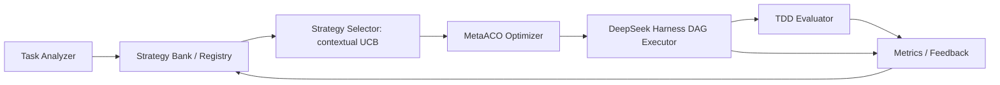

# Архитектура и правила развития

Дополнение 2026-10-25 для рабочей ветки `codex/tdd-evaluator`: новые инструкции из main@aa75488 синхронизированы; Strategy Bank дополнен timeout и EvaluationResult v2 в commit 48eb5e2. Локальный Node TDD Evaluator описан в [tdd-evaluator.md](tdd-evaluator.md) и ADR 0002. Это возможности feature-веток, не заявление об их слиянии в main. Остальной раздел ниже сохраняет явно указанную историческую базу проверки.

## Проверенная база и целевое состояние

Дата проверки: 2026-10-25. База PR — GitHub `main`, commit
`08e0a1e4c39705260afb763ceceaf7b163e482f8`. Проверены `index.js`, `planner.js`,
`python/metaaco_plan.py`, package.json и тесты. Эта документация не добавляет runtime.

В main реализован адаптер DeepSeek Harness: фиксированные последовательные стадии,
параллельные дети внутри стадии, preview, явный запуск, отмена и освобождение ресурсов.
Python-мост импортирует внешний RCPSP solver, проверяет расписание и экспортирует
план v1 `serial-order`: ровно один агент в каждой стадии. `validatePlan()` и
`runPlannedWorkflow(..., {allowLlm: true})` — реальные JS-интерфейсы.
В Python реальные функции — `make_plan(schedule, instance, tasks)` и `main()`.
Вход CLI: `--source`, `--instance`, `--tasks`, необязательный `--seed`.

В просмотренной локальной ветке `codex/strategy-bank@5f9a07913e9f06c9512ae3e647100832e7aee8c0`
имеются SQLite-банк (`src/bank/`), схемы и тесты, агентный RCPSP-вход
`python/agent_problem.py`, планы v2 и `start-groups`. Они не входят в указанную
базу main. Существующие документы этой ветки — `docs/strategy-bank.md`,
`docs/agent-resources.md`, `docs/architecture-audit.md` — изучать после её подключения;
здесь это пути в другой ревизии, а не ссылки на файлы данной базы.

Task Analyzer, contextual selector, независимый TDD Evaluator, полный Metrics
Collector и Feedback в main отсутствуют. Произвольный DAG с передачей артефактов
и выбором моделей также является целью, а не свойством текущего исполнителя.

## Целевой поток

Collector должен получать события всех этапов, включая анализ, планирование,
ожидание, ошибки и оценку. Evaluator запускается на границах RED/GREEN/REFACTOR.
На первых этапах допустимы фиксированные стратегии без оптимизатора.

| Компонент | Целевая ответственность / результат |
|---|---|
| Task Analyzer | Тип задачи, стек, сложность, риск, confidence и признаки, доступные до исполнения |
| Bank / Registry | Неизменяемые версии стратегий, совместимость, история всех попыток и артефактов |
| Selector | Фильтрация по политике и выбор стратегии/маршрута моделей с учётом контекста |
| MetaACO | Допустимый порядок и распределение ресурсов в пределах зафиксированной модели |
| DAG Executor | Зависимости, лимиты одновременности, отмена, retry-policy, provenance входов/выходов |
| TDD Evaluator | Независимое подтверждение качества и TDD evidence |
| Metrics / Feedback | Измерения, расчёт стоимости, завершение попытки и версионированное обновление опыта |

Приоритет реализации: Bank → Evaluator → Collector → Analyzer → Selector → DAG →
Optimizer → Feedback. Сначала довести надёжное хранение и проверку исходов;
оптимизация без них создаёт недостоверное обучение. При переносе работы сверять
существующие PR и миграции, не создавать второй банк.

## Контракты будущих компонентов

Следующие сущности — проектные контракты, не заявления о существующих классах/API.
У каждой нужны schemaVersion, стабильный ID, UTC timestamps, source/provenance.

| Сущность | Минимальные данные |
|---|---|
| TaskRequest / TestSpec | taskId, repo/baseCommit, требования, acceptance criteria, закреплённые тесты |
| UserPolicy | Разрешённые модели/инструменты, бюджет денег/времени, concurrency, веса целей |
| StrategyDefinition | strategyId/version, роли, DAG, маршруты моделей, TDD-policy, совместимость |
| SelectionDecision | Признаки до запуска, кандидаты/исключения, scores, seed, policy revision, snapshot банка |
| ExecutionPlan | Версия, зависимости, ресурсы, назначения, artifact bindings, прогнозы и solver provenance |
| AttemptRecord | taskId, strategy version, base/final commit, состояния, причины, ссылки на события и артефакты |
| ModelCallRecord | Модель/версия, requestId, latency, input/output/cache/reasoning usage, источник, pricing snapshot |
| TestReport | Фаза, команда, среда, test hash, exit code, counts, duration, stdout/stderr, timeout |
| EvaluationResult | success/failed/inconclusive, обязательные gates, RED/GREEN/REFACTOR и regression evidence |

Хранилище: использовать уже разработанный SQLite-банк после проверки его PR.
Сохранять версии стратегий неизменяемо, события добавлять идемпотентно,
артефакты адресовать по хешу. Одна задача → много попыток → много model calls/test runs.
Node orchestration — владелец записи; Python возвращает проверяемые данные.
После падения процесса незавершённая попытка становится interrupted, не success;
автоматический повтор оплачиваемого запроса без действующего разрешения запрещён.

## Независимая TDD-оценка

1. Закрепить acceptance criteria, исходный commit и TestSpec до генерации патча.
2. RED: новый целевой тест должен упасть на исходном коде из-за ожидаемого дефекта.
   Сбой импорта, недоступность сети или ошибка runner не доказывают RED.
3. GREEN: применить патч и прогнать целевые, обязательные и регрессионные тесты.
4. REFACTOR: сохранить функциональность и повторить обязательные проверки.
5. Независимый evaluator из доверенной среды проверяет артефакты и тесты;
   агент-автор не меняет контрольный набор или критерии для получения успеха.

Изменения тестов допустимы как часть разработки, но контрольный набор сохраняется
отдельно и сверяется по хешу. Сохранять и созданные агентом тесты, и независимые.
Self-report агента и `stopReason: completed` не являются оценкой корректности.
Отдельно хранить functional correctness и TDD compliance: рабочий патч без RED
не доказывает соблюдение TDD. Неполная оценка — inconclusive с причиной.

## Цели, contextual UCB и стоимость

Сначала отфильтровать недопустимые стратегии: бюджет, модели, инструменты,
ресурсы и обязательное качество. Затем сравнивать допустимые по времени/качеству/стоимости.
Не позволять малой цене компенсировать провал обязательных тестов.
Для эксперимента заранее закреплять нормировки и веса, например
`reward = wq*quality - wt*normalizedTime - wc*normalizedCost` с документированными
границами и отдельной политикой для неуспеха/неполных исходов.

Contextual UCB выбирает стратегию и разрешённый маршрут моделей по признакам задачи,
прогнозу полезности и uncertainty bonus. Зафиксировать конкретную модель (например,
LinUCB), feature schema, cold-start, коэффициент exploration и update-policy до
эксперимента. Это будущая реализация, а не интерфейс Python `ColonyBanditController`.
Логировать вероятности выбора, если известны; для детерминированного UCB не выдумывать propensity.

Дорогие и дешёвые LLM задаются конфигурацией с provider/model revision и датированным
тарифом; не закреплять выдуманные актуальные цены. Поддержку назначения моделей
и возврата usage проверить на фактически установленном Harness до внедрения.

Разделять `estimates` и `actuals`: wall time (включая анализ, планирование, очередь,
LLM, тесты), CPU/solver time, токены, retries, тестовые результаты, рассчитанную
стоимость и отдельный provider-reported billing. Время измерять монотонными часами;
денежные значения — целые microunits с валютой. Неизвестный usage/cost — null с причиной.
Считать расходы провалов и всех повторов. Прогноз Cmax не является фактической latency.

## Воспроизводимые эксперименты

До запуска сохранить manifest: commit проекта, хеши внешнего solver/данных/тестов,
версии среды и зависимостей, конфигурации моделей и промптов, seeds, solver budgets,
concurrency, policy, pricing snapshot, bank snapshot и правила остановки.
Реальные LLM могут оставаться недетерминированными даже при одинаковом seed;
повторяемость протокола не означает побитовую повторяемость ответов.

Разделить задачи на train/validation/held-out test по репозиториям/семействам и времени,
исключить дубликаты и утечки решений. Признаки вычислять до исхода. На тесте банк
и policy фиксировать; для online-режима заранее определить временной порядок
обновления только по уже завершённым прошлым задачам и отчётность отдельно от frozen evaluation.

Обязательная матрица на одинаковых задачах, лимитах и правилах оценки:

| Вариант | Определение |
|---|---|
| random | Случайная допустимая стратегия/маршрут с фиксируемым seed |
| fixed | Одна заранее выбранная стратегия для всех совместимых задач |
| cheapest | Самый дешёвый допустимый маршрут по закреплённому прогнозу стоимости |
| historical-best | Лучшая совместимая стратегия по прошлым train-исходам, без test oracle |
| contextual bandit | Контекстный selector с теми же допустимыми стратегиями, без MetaACO |
| MetaACO without bank | Настоящий solver без межзадачного опыта Strategy Bank |
| MetaACO+bank | Тот же solver и бюджеты с доступом к разрешённому прошлому опыту |

В последних двух вариантах внутренний EliteArchive по умолчанию одинаково включён:
«without bank» означает отсутствие постоянного Strategy Bank, не отключение элитных
расписаний. Отдельные ablation: elite off, replication off, local search off,
UCB/random/round_robin колоний; не смешивать их с основным сравнением.

Использовать парные задачи/seeds, несколько повторов, заранее заданное число запусков,
рандомизацию порядка для уменьшения временных эффектов провайдера. Фиксировать равные
денежные/временные квоты, solver evaluation limits и весь overhead чтения банка/поиска.
Отчитываться по success rate, TDD compliance, regression failures, median/p95 времени,
стоимости всех попыток и стоимости на успех; показывать разброс/доверительные интервалы,
размер выборки и timeout/cancelled/inconclusive. Не отбрасывать провалы и не заявлять
статистическое преимущество без достаточных данных. Offline replay полезен для
контрактов, но не доказывает реальную экономию на LLM. Платные серии здесь не разрешены.

## Совместимость и ограничения

Текущий main экспортирует последовательный Python-план: его makespan не измеряет
время последовательного Harness. В более новой ветке `start-groups` использует барьеры
и также теряет перекрытие работ с разными временами старта. План v2 содержит прогнозы,
а не фактические метрики. Не приписывать ни одной проекции свойства полноценного DAG executor.
Результаты сейчас не передаются зависимым задачам автоматически. Не расширять молча
смысл v1/v2: новый DAG/model/artifact контракт вводить отдельной версией с проверками.
