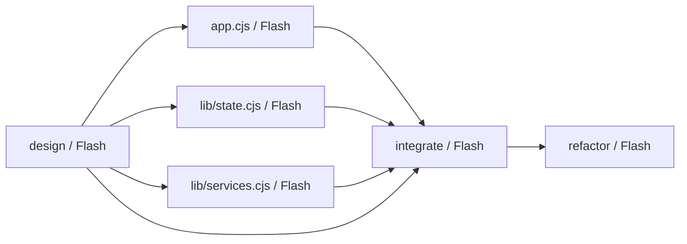

# Контрольный webhook-пилот v3: результаты

21 ноября 2026 (Europe/Samara). [Протокол v3](webhook-pilot-v3-protocol.md)
соблюдён: пять условий, seed 7, одна попытка на условие, без paid retries,
изменений runtime/промптов по исходам и ручной замены решения MetaACO.
Source 3fd5163 и driver SHA-256 закреплены до вызовов. Всего **12 реальных
API-вызовов**, расчётные расходы **$0.063186 из разрешённых $2**, остаток
$1.936814, held=0, полный учёт. Это цена по usage/закреплённым тарифам,
не подтверждённый счёт провайдера.

## Результаты

| Условие | Вызовы | Расчёт USD | Время коллектора, с | Acceptance | Полный TDD |
|---|---:|---:|---:|---|---|
| Direct Flash | 1 | 0.003430 | 10.659 | passed | inconclusive |
| Direct Pro | 1 | 0.014370 | 17.566 | failed | failed |
| Fixed | 2 | 0.007364 | 18.774 | passed | passed |
| Components | 6 | 0.031020 | 63.533 | passed | passed |
| MetaACO | 2 | 0.007002 | 21.554 | passed | passed |

Acceptance подтверждена в четырёх попытках, полный TDD — в трёх. Direct Flash
прошёл 12 target и 2 regression tests, но REFACTOR отсутствует по его протоколу:
Bank state=inconclusive не превращается в TDD success. У Fixed/Components/MetaACO
обе GREEN и REFACTOR фазы прошли по 12 target + 2 regression. Все имеют правильный
baseline, а исходный RED дал 12 ожидаемых ERR_ASSERTION.

Время включает измеренную работу попытки и независимые проверки, не только API.
Планирование и внешний driver wall time сохранены отдельно. Провалы могут завершаться
раньше успешного полного маршрута. По одной попытке на одной задаче нельзя оценивать
вероятности успеха, статистическое превосходство или качество моделей в целом.

## Реальное компонентное исполнение

Design вернул typed architecture DTO без строкового JSON-в-JSON. Host сформировал
architecture.json и назначил файлы по решению модели:

| Слот | Файлы, выбранные моделью | Ответственность по её контракту |
|---|---|---|
| a | app.cjs | Синхронная публичная точка входа и маршрутизация |
| b | lib/state.cjs | In-memory состояние, idempotency, атомарное резервирование доставки |
| c | lib/services.cjs | Бизнес-операции и асинхронная доставка/повторы |

Названия и приватные интерфейсы не задавались авторами сценария заранее.
Все три implement выполнились, integrate получил их результаты и design,
далее независимые GREEN и REFACTOR прошли. Количество слотов (три) и структура
этого baseline заданы конфигурацией; это не самостоятельный выбор MetaACO.



Максимум одновременно находившихся в работе API-вызовов — **2**. Перекрытие
получено из одного monotonic clock коллектора: completion monotonicMs минус
latencyMs даёт начало guard-интервала. Интервалы и источник вывода сохранены
в data-таблице; это наблюдение отправителя, не телеметрия GPU/очередей провайдера.
Все шесть calls имеют полный usage и урегулированный budget ledger.

## Что выбрал MetaACO

Настоящий solver выполнил **100** локальных оценок, включая первую initialization.
Минимальные два layout сравнивались при структурной подготовке. Выбран monolith:

```text
implement / deepseek-flash → refactor / deepseek-flash
```

Forecast 20s и 12714 microunits основан на неизмеренных priors, не является
фактической ценой или доказательством корректности. Факт: оба узла исполнились,
код прошёл GREEN и REFACTOR; измерено 21.554s и 7002 microunits. Full trace,
альтернативные назначения и фактические dependency artifacts сохранены в manifest
и банке. MetaACO не выбрал компонентный граф. Его маршрут совпал с Fixed.

Банк каждого условия изолирован и пуст при выборе. Между попытками нет feedback
обучения; критерий качества во время поиска не получает реальных исходов этой
серии. Поэтому это end-to-end проверка поиска/исполнения, а не обученная колония
и не демонстрация превосходства MetaACO. Runtime priors и ограничение стоимости
надо отличать от многокритериальной оптимизации на измеренной истории.

## Провал Pro

У Direct Pro формат ответа принят, host восстановил README, синхронный API
совместим: обе регрессии прошли. Из target tests прошли 8/12. Провалены:

- worker delivers signed event once — status pending вместо delivered;
- exception schedules retry and respects injected clock — nextAttemptAt 0 вместо 100;
- non 2xx exhausts attempt limit — pending вместо failed;
- recipient failures do not block others — доставки не стали delivered.

Это конкретные ошибки результата по закреплённым тестам. Корневой механизм
в исходнике этой записью не установлен; нельзя приписывать все четыре ошибки
одной предполагаемой причине без отдельного аудита. Попытка и её расходы сохранены,
исправлений/повторов после просмотра тестов не выполнялось.

## Транспорт и ограничения выводов

Во всех принятых ответах raw DTO имеет schemaVersion=2; модель не возвращает
read-only файлы. Host добавил точный pinned README в полные implement/integrate/
refactor снимки. Raw и normalized bytes хранятся раздельно, их хеши проверены.
Содержимое программного кода при нормализации не переписывается. Design и частичные
компоненты не получают фиктивный полный snapshot с исходным app.cjs.

Ошибки newline и лишнего type в этой серии не повторились, но один пилот не
гарантирует, что будущая модель никогда не нарушит JSON-контракт. Формат, явная
формулировка sync и source менялись вместе; причинный эффект отдельного изменения
не выделен. API sampling не фиксируется solver seed: seed 7 относится к локальному
поиску, а cloud-ответы не обязаны повторяться. ModelRevision в адаптере — закреплённая
метка тарифа/ожидаемой версии, а не аттестация весов за API alias.

Серия инфраструктурная, validation-candidate; результаты не следует автоматически
превращать в учебные наблюдения или считать независимыми held-out задачами.
Следующий этап требует новых заранее объявленных train/validation/test задач,
протокола обновления истории и отдельной замороженной оценки переноса. Накопленные
банки позволяют аудит и подготовку такого дизайна, но обучение пока не проводилось.

## Доказательства

[Сокращённые метрики, фазы, выбранные планы, архитектура модели, concurrency и хеши](data/webhook-pilot-v3-summary.json).
Проверены SHA-256 всех экспортированных артефактов, соответствие cost каждого call
его attempt ledger и общий итог: 3430 + 14370 + 7364 + 31020 + 7002 = 63186.
Ни одной незавершённой/неурегулированной резервации нет. Calls: Pro 1, Flash 11.

Lenovo: /home/irakli/agent-lab/webhook-response-v3.MjY8nWo7/pilot-v3/;
рядом pilot-v3.log. Локальная копия: work/webhook-pilot-v3-3fd5163/pilot-v3/.
Успешный код извлечён в work/webhook-pilot-v3-3fd5163/generated/ с каталогом
на каждый прошедший метод. Сырые prompts, SQLite и полный код вне Git.
Завершённые v1/v2 данные и протоколы сохранены. Эта запись не меняет runtime.
